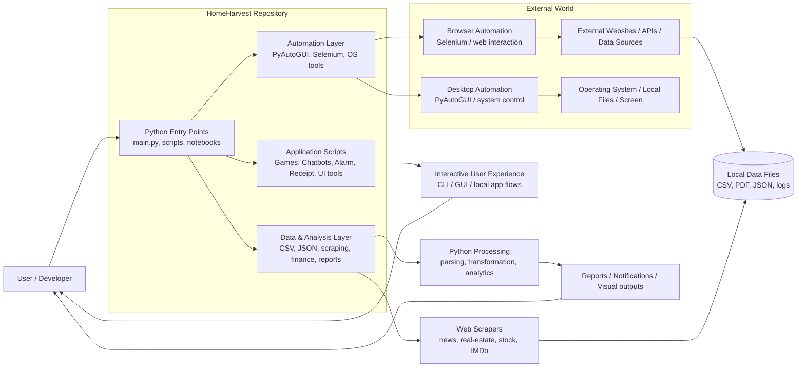

# HomeHarvest Architecture Overview

This repository is a Python experimentation and automation workspace: it combines scripts for desktop automation, web scraping, chatbot interactions, game logic, data processing, and reporting. The architecture below reflects that broad set of capabilities.

## Architectural Notes

- Entry points are a mix of standalone scripts and small app modules rather than a single monolithic application.
- The repository uses a layered approach:
  - User interaction layer
  - Automation layer
  - Data acquisition and processing layer
  - Output/reporting layer
- External dependencies include websites, browser automation, local system control, and local/generated files.
- The design is intentionally flexible and script-oriented, suitable for experimentation and learning rather than a production service architecture.

## Typical Components in the Repo

- Automation scripts: UI control, browser interaction, system operations
- Data scraping scripts: news, real estate, movies, stocks
- Utility apps: receipt generator, chatbot, alarm clock, todo list
- Data outputs: CSV, PDF, reports, generated logs
- Experimental tools: games, visualizers, and learning projects
